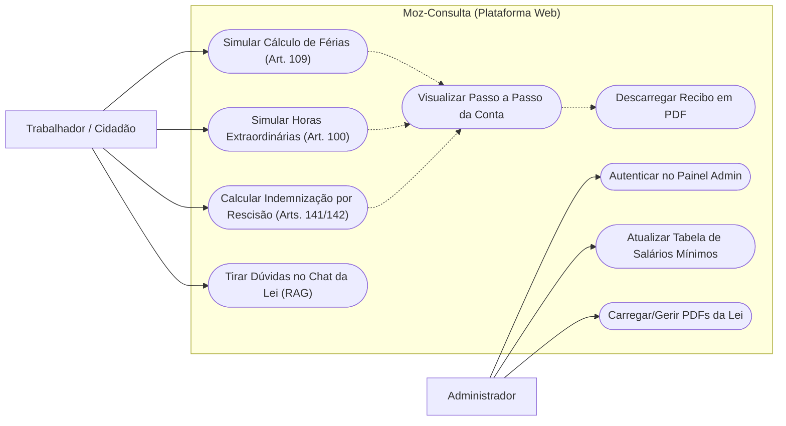
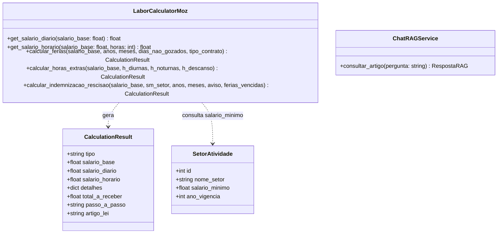

# FASE 2: ESPECIFICAÇÃO DE REQUISITOS E ARQUITETURA DO SISTEMA

Este documento define os Requisitos Funcionais, Requisitos Não-Funcionais e os Diagramas UML (Casos de Uso e Classes) da plataforma **Moz-Consulta**, respeitando os padrões de Engenharia de Software (*Pressman & Maxim, 2021*).

---

## 1. Requisitos do Sistema

### 1.1. Requisitos Funcionais (RF)

| ID | Nome | Descrição | Ator Principal |
| :--- | :--- | :--- | :--- |
| **RF01** | Calcular Férias | O sistema deve calcular o valor a receber e os dias de férias (12 dias no 1.º ano, 30 dias a partir do 2.º ano ou 1 dia/mês a prazo) com base no salário e tempo de serviço (Art. 109). | Trabalhador / Empregador |
| **RF02** | Calcular Horas Extras | O sistema deve calcular o valor de trabalho suplementar aplicando +50% (diurnas), +100% (noturnas) e +100% (descanso/feriados) (Art. 100). | Trabalhador / Empregador |
| **RF03** | Calcular Indemnização por Rescisão | O sistema deve calcular a indemnização por fim de contrato sem justa causa com base no enquadramento por escalões (1-7 SM, 8-10 SM, 11-16 SM, >16 SM), compensação de aviso prévio e férias proporcionais (Arts. 139, 141 e 142). | Trabalhador / Empregador |
| **RF04** | Exibir Passo a Passo das Contas | O sistema deve apresentar a memória de cálculo explicada em linguagem clara, detalhando o salário diário, horário e artigos legais aplicados. | Trabalhador / Empregador |
| **RF05** | Gerar Relatório/Recibo em PDF | O sistema deve permitir o download de um recibo informativo com o resumo da simulação realizada e aviso legal. | Trabalhador / Empregador |
| **RF06** | Consultar Assistente da Lei (RAG) | O utilizador pode submeter perguntas em linguagem natural e o sistema responde citando os artigos da Lei n.º 13/2023. | Trabalhador / Empregador |
| **RF07** | Listar Setores e Salários Mínimos | O sistema deve disponibilizar a lista atualizada de setores econômicos moçambicanos e seus respetivos salários mínimos. | Todos |
| **RF08** | Autenticação do Administrador | O sistema deve permitir o login seguro do administrador para gestão dos parâmetros. | Administrador |
| **RF09** | Atualizar Salários Mínimos | O administrador deve poder alterar os valores dos salários mínimos anuais sem alterar o código-fonte da aplicação. | Administrador |
| **RF10** | Gestão de Documentos Legais | O administrador pode carregar novos arquivos PDF da legislação laboral para atualização da base de conhecimento do RAG. | Administrador |

### 1.2. Requisitos Não-Funcionais (RNF)

| ID | Categoria | Descrição |
| :--- | :--- | :--- |
| **RNF01** | **Custo Zero (Gratuidade)** | A plataforma deve operar em infraestrutura gratuita (Front-end na Vercel, Back-end no Render e PostgreSQL no Supabase/Neon). |
| **RNF02** | **Desempenho** | As respostas de cálculos determinísticos devem ser processadas em menos de 200 milissegundos. |
| **RNF03** | **Responsividade** | A interface visual deve adaptar-se a ecrãs de smartphones, tablets e computadores pessoais. |
| **RNF04** | **Usabilidade (SUS)** | A interface deve ser simples para o cidadão comum, com meta de avaliação SUS $\ge 70$ pontos (*Hertzum, 2022*). |
| **RNF05** | **Fidelidade Jurídica (Zero Alucinação)** | A calculadora deve ter 100% de exatidão aritmética e o assistente de texto deve basear-se no texto oficial da Lei 13/2023. |
| **RNF06** | **Privacidade e Ética** | O sistema não armazena nomes reais, números de BI ou dados bancários dos utilizadores nas simulações públicas. |

---

## 2. Diagramas UML

### 2.1. Diagrama de Casos de Uso

### 2.2. Diagrama de Classes do Domínio de Cálculos

